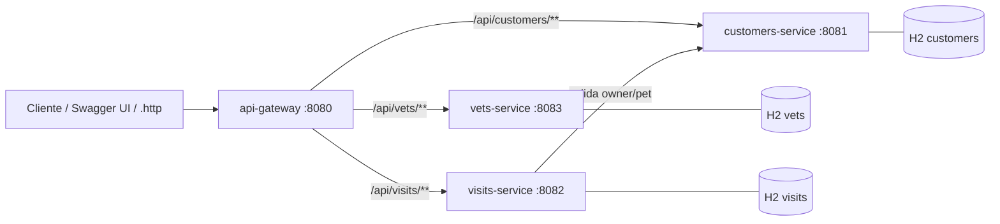

# PetClinic Modernization

Reescritura del monolito [Spring PetClinic](https://github.com/spring-projects/spring-petclinic)
como **microservicios Spring Boot 4.1 en Java 21**, con **REST documentado con OpenAPI**, tests de
paridad que preservan cada regla del original y GitFlow con historial limpio.

> El monolito original está conservado íntegro en el historial y en el tag **`legacy-java21`**
> (ver [`legacy/README.md`](legacy/README.md)).

> **Estado de publicación**: el repositorio está listo para publicarse como
> `<usuario>/petclinic-modernization`; la CI (`.github/workflows/ci.yml`) se ejecutará en el primer
> push. Los pasos exactos están en [`docs/agent/PROGRESS.md`](docs/agent/PROGRESS.md) §«Publicación».

## Arquitectura



| Módulo | Puerto | Responsabilidad |
|---|---|---|
| `services/customers-service` | 8081 | Owners, pets y tipos de mascota (escritura) |
| `services/visits-service` | 8082 | Visitas; valida owner/pet contra customers |
| `services/vets-service` | 8083 | Veterinarios y especialidades (solo lectura, cacheado) |
| `api-gateway` | 8080 | Enrutado, Swagger agregado y composición owner+pets+visits |
| `libs/common-web` | — | `ProblemDetail`, excepciones HTTP y envoltorio de paginación |
| `tests/parity-tests` | — | Guardián de trazabilidad regla → test |

Decisiones y ADRs: [`docs/ARCHITECTURE.md`](docs/ARCHITECTURE.md).

## Requisitos

- **JDK 21** (Temurin recomendado). No hace falta Maven: se usa el wrapper.
- Windows, Linux o macOS.
- **Docker solo si quieres usar Compose**; los servicios corren sin bases de datos externas (H2 en
  memoria).

## Quick start (≤ 5 comandos)

```bash
git clone <URL-del-repo> petclinic-modernization && cd petclinic-modernization
./mvnw -B verify                                   # compila, testea y valida la paridad
./mvnw -pl services/customers-service spring-boot:run   # :8081
./mvnw -pl services/visits-service spring-boot:run      # :8082
./mvnw -pl services/vets-service spring-boot:run        # :8083
```

En otra terminal:

```bash
./mvnw -pl api-gateway spring-boot:run             # :8080
curl http://localhost:8080/api/owners/6/details
```

Y abre **http://localhost:8080/swagger-ui.html** (cuatro especificaciones: customers, vets, visits y
gateway).

En Windows usa `mvnw.cmd` en lugar de `./mvnw`.

## Ejecutar con Docker Compose

```bash
docker compose up --build
# gateway    -> http://localhost:8080
# swagger    -> http://localhost:8080/swagger-ui.html
```

Cada servicio se construye con el `Dockerfile` multi-stage de la raíz
(`--build-arg MODULE=… --build-arg PORT=…`), se espera a su `healthcheck` y `visits-service`
recibe `CUSTOMERS_SERVICE_URL=http://customers-service:8081`.

> **Aviso**: el `docker-compose.yml` de este repositorio **no se ha podido ejecutar** en la máquina
> de desarrollo (no hay Docker). Está validado por revisión y así se documenta en
> [`docs/TESTING.md`](docs/TESTING.md).

## URLs útiles

| Qué | URL |
|---|---|
| Swagger UI agregado | http://localhost:8080/swagger-ui.html |
| OpenAPI de cada servicio | `/api/customers/v3/api-docs`, `/api/vets/v3/api-docs`, `/api/visits/v3/api-docs` |
| Actuator | `/actuator/health`, `/actuator/info`, `/actuator/metrics` |
| Composición | http://localhost:8080/api/owners/6/details |
| Error intencionado (demo) | http://localhost:8080/api/system/boom |

Colección de pruebas: [`docs/http/`](docs/http/) (`customers.http`, `vets.http`, `visits.http`,
`gateway.http`).

## API en 30 segundos

```bash
# Buscar owners por prefijo de apellido
curl "http://localhost:8080/api/customers/owners?lastName=fran"

# Crear owner (201 + Location)
curl -i -X POST http://localhost:8080/api/customers/owners \
  -H 'Content-Type: application/json' \
  -d '{"firstName":"Ada","lastName":"Lovelace","address":"12 Analytical St.","city":"London","telephone":"6000000001"}'

# Añadir mascota (409 si el nombre ya existe para ese owner)
curl -i -X POST http://localhost:8080/api/customers/owners/1/pets \
  -H 'Content-Type: application/json' \
  -d '{"name":"Ada cat","birthDate":"2020-02-02","typeId":1}'

# Reservar visita (fecha estrictamente futura)
curl -i -X POST http://localhost:8080/api/visits/owners/6/pets/7/visits \
  -H 'Content-Type: application/json' \
  -d '{"date":"2027-01-15","description":"annual checkup"}'
```

Errores uniformes (RFC 9457):

```json
{
  "type": "about:blank#validation-failed",
  "title": "Validation failed",
  "status": 400,
  "detail": "The request body contains invalid fields",
  "instance": "/owners",
  "errors": [ { "field": "telephone", "message": "Telephone must be a 10-digit number" } ]
}
```

Contrato completo: [`docs/API.md`](docs/API.md).

## Tests

```bash
./mvnw verify                    # 117 tests + paridad + JaCoCo
./mvnw -pl services/vets-service test -Dtest='VetControllerTests'
```

| Módulo | Tests |
|---|---|
| customers-service | 56 |
| vets-service | 16 |
| visits-service | 30 |
| api-gateway | 13 |
| parity-tests | 2 |
| **Total** | **117** |

Cobertura de líneas (JaCoCo): 93,3 % customers · 96,6 % vets · 96,6 % visits · 97,3 % gateway.
Pirámide y trazabilidad regla → test en [`docs/TESTING.md`](docs/TESTING.md).

## Estructura del repositorio

```
.
├── pom.xml                    parent (Java 21, Spring Boot 4.1.0)
├── libs/common-web/           ProblemDetail, excepciones, PageResponse
├── services/
│   ├── customers-service/     api · application · domain · infrastructure
│   ├── vets-service/
│   └── visits-service/
├── api-gateway/               rutas MVC + composición + Swagger agregado
├── tests/parity-tests/        guardián de trazabilidad
├── docs/
│   ├── ANALYSIS.md            análisis del monolito
│   ├── ARCHITECTURE.md        diagramas y ADRs
│   ├── API.md                 contrato REST
│   ├── TESTING.md             pirámide, cobertura y trazabilidad
│   ├── MIGRATION.md           versiones verificadas y cambios de comportamiento
│   ├── AI_USAGE.md            uso de IA, con errores detectados y corregidos
│   ├── http/                  colección de peticiones
│   └── agent/                 meta-prompting (META_PROMPT, PLAN, BUSINESS_RULES…)
├── Dockerfile                 imagen multi-stage para cualquier servicio
├── docker-compose.yml         los cuatro servicios
└── legacy/README.md           dónde vive el monolito original
```

## Estrategia de ramas (GitFlow)

```
main ──●──────────────────────────────────────────●── (v1.0.0)
        \                                        /
develop  ●──●──────●──────●──────●──────●──────●
             \    / \    / \    / \    /  \   /
            feature/*   ...    ...   ...  release/1.0.0
```

- `main` solo recibe releases; `develop` integra.
- Cada fase es una rama `feature/<nombre>` mergeada con `--no-ff`.
- Commits en [Conventional Commits](https://www.conventionalcommits.org/):
  `feat(customers): …`, `test(visits): …`, `docs: …`, `build: …`.

Para contribuir: rama desde `develop`, `./mvnw verify` en verde, commit convencional y merge
`--no-ff`. No se aceptan commits directos a `main`.

## Limitaciones conocidas y trabajo futuro

- **UI**: las vistas Thymeleaf no se portan (el alcance es backend). La UI de inspección es Swagger
  UI y los `.http`.
- **Docker Compose** no se ha ejecutado en la máquina de desarrollo (sin Docker).
- **XML** en `/vets`: no existía realmente en el original (ver BR-VET-02b) y queda como opcional.
- **Resilience4j**: no se añadió; hay timeouts y 503, pero no *circuit breaker*.
- **Bases de datos**: H2 en memoria. El perfil PostgreSQL está documentado, no implementado por
  servicio.
- **Sin seguridad** (autenticación/autorización) ni *service discovery*: fuera del alcance.
- El borrado de un owner no se propaga a sus visitas (integridad entre contextos por contrato HTTP).

## Documentación y uso de IA

- Análisis del legado: [`docs/ANALYSIS.md`](docs/ANALYSIS.md)
- Decisiones: [`docs/ARCHITECTURE.md`](docs/ARCHITECTURE.md) (ADR-001 … ADR-006)
- Migración y versiones verificadas: [`docs/MIGRATION.md`](docs/MIGRATION.md)
- Uso de IA (prompts, validación y errores detectados): [`docs/AI_USAGE.md`](docs/AI_USAGE.md)
- Instrucciones para agentes: [`AGENTS.md`](AGENTS.md) y [`docs/agent/`](docs/agent/)

## Licencia

Apache License 2.0, igual que el proyecto original ([LICENSE.txt](LICENSE.txt)).
