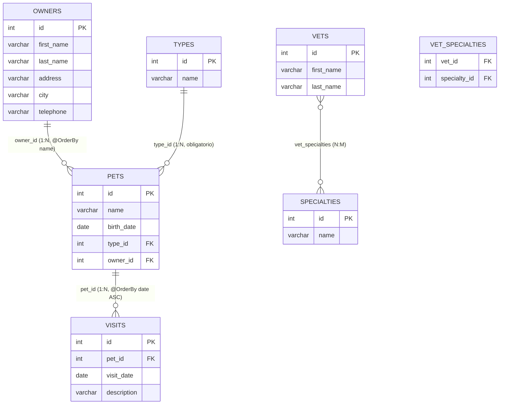
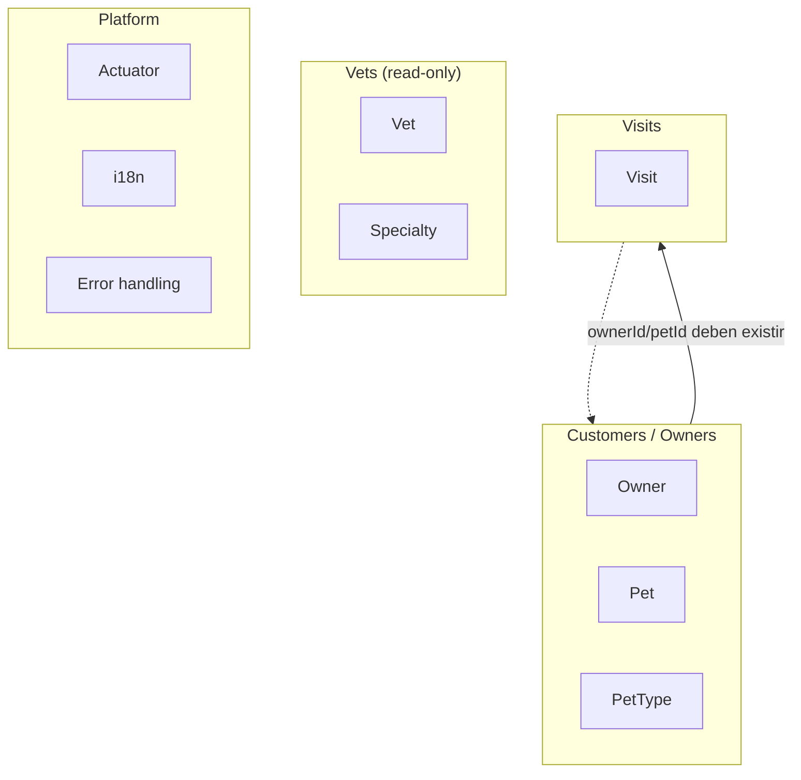

# Análisis del monolito `spring-petclinic` (Fase 0)

> Estado analizado: commit `500158f` ("added redirection to the page when the user types a page
> that is out of bounds"), Spring Boot `4.1.0`, `java.version=17`.
> Análisis hecho leyendo **todo** `src/main` y `src/test`, no solo la documentación previa.
> Las reglas de negocio destiladas están en [`docs/agent/BUSINESS_RULES.md`](agent/BUSINESS_RULES.md),
> validadas y ampliadas en esta fase.

## 1. Resumen ejecutivo

El repositorio es la aplicación de demostración oficial de Spring: un **monolito Spring Boot +
Spring MVC + Thymeleaf + JPA/Hibernate** con tres áreas funcionales (owners/pets, visits, vets) y
un pequeño módulo `system` (bienvenida, error intencionado, i18n, caché, configuración web).

Características que condicionan la modernización:

- **No hay API REST de negocio.** Solo `/vets` devuelve JSON (`@ResponseBody`). El resto son
  controladores MVC que devuelven vistas Thymeleaf y **redirecciones** (`redirect:/owners/...`).
  Por tanto, los códigos HTTP del monolito son 200/302/400/500; los 404/409/503 que pide la
  arquitectura objetivo **son semántica nueva** que hay que definir y documentar.
- **El modelo de dominio son las entidades JPA** y se usan directamente como *form objects*.
  El binding de formularios a entidades se mitiga con `@InitBinder#setDisallowedFields("id","*.id")`.
- **Toda la validación vive en tres sitios**: anotaciones Jakarta Validation (`Owner`, `Person`,
  `Visit`, `NamedEntity`), un `Validator` programático (`PetValidator`) y reglas en los
  controladores (fechas futuras, duplicados, pertenencia pet↔owner, paginación).
- La **búsqueda case-insensitive** depende de que H2 declare `last_name`/`pets.name` como
  `VARCHAR_IGNORECASE`; MySQL/Postgres no tienen esa garantía (depende de colación). Es una
  inconsistencia real del original que hay que decidir explícitamente en la nueva arquitectura.
- **No hay OpenAPI, ni DTOs, ni versionado, ni `@ControllerAdvice`**: los errores de "no existe"
  (`IllegalArgumentException`) terminan en **HTTP 500**, no en 404.

## 2. Modelo de dominio (ER)



Notas de mapeo:

| Entidad | Tabla | Superclase | Detalles |
|---|---|---|---|
| `Owner` | `owners` | `Person` → `BaseEntity` | `pets` es `@OneToMany(cascade=ALL, EAGER)` con `@JoinColumn(owner_id)` y `@OrderBy("name")`. **No** hay `owner_id` en el lado `Pet`, es una relación unidireccional. |
| `Pet` | `pets` | `NamedEntity` → `BaseEntity` | `type` es `@ManyToOne` obligatorio en BD (`type_id NOT NULL`). `visits` es `@OneToMany(cascade=ALL, EAGER)` `@OrderBy("date ASC")`. |
| `PetType` | `types` | `NamedEntity` | Catálogo de solo lectura en la práctica (6 filas semilla). |
| `Visit` | `visits` | `BaseEntity` | El constructor fija `date = LocalDate.now().plusDays(1)`. |
| `Vet` | `vets` | `Person` | `specialties` `@ManyToMany(EAGER)`; getter devuelve copia ordenada por nombre. |
| `Specialty` | `specialties` | `NamedEntity` | — |

`VARCHAR_IGNORECASE` (solo H2) en `owners.last_name` y `pets.name`; constraint
`unique_owner_pet_name UNIQUE (owner_id, name)`; en Postgres el equivalente es un índice único
sobre `LOWER(name)`.

## 3. Endpoints existentes

### 3.1 MVC (devuelven vistas Thymeleaf)

| Método | Ruta | Entrada | Salida | Notas |
|---|---|---|---|---|
| GET | `/` | — | vista `welcome` | `WelcomeController` |
| GET | `/owners/find` | — | vista `owners/findOwners` | formulario de búsqueda |
| GET | `/owners` | `page` (def. 1), `lastName` (binding a `Owner`) | vista lista / redirect | prefijo de apellido, size 5, página fuera de rango → `redirect:/owners?page=1[&lastName=…]`; 0 resultados → error de campo `notFound`; 1 resultado → `redirect:/owners/{id}` |
| GET | `/owners/new` | — | vista formulario alta | — |
| POST | `/owners/new` | form | `redirect:/owners/{id}` o vista con errores | `@Valid Owner` |
| GET | `/owners/{ownerId}` | — | vista `ownerDetails` | owner inexistente → `IllegalArgumentException` (500) |
| GET | `/owners/{ownerId}/edit` | — | vista formulario edición | — |
| POST | `/owners/{ownerId}/edit` | form | `redirect:/owners/{ownerId}` | id del form debe coincidir con la URL, si no error + redirect a edición |
| GET | `/owners/{ownerId}/pets/new` | — | vista formulario pet | añade un `Pet` nuevo al owner en memoria |
| POST | `/owners/{ownerId}/pets/new` | form | `redirect:/owners/{ownerId}` o vista | `PetValidator` + duplicado + fecha no futura + violación de unicidad |
| GET | `/owners/{ownerId}/pets/{petId}/edit` | — | vista formulario pet | — |
| POST | `/owners/{ownerId}/pets/{petId}/edit` | form | `redirect:/owners/{ownerId}` | duplicado excluyendo el propio pet |
| GET | `/owners/{ownerId}/pets/{petId}/visits/new` | — | vista formulario visita | `minVisitDate = hoy + 1` para el date picker |
| POST | `/owners/{ownerId}/pets/{petId}/visits/new` | form | `redirect:/owners/{ownerId}` o vista | fecha estrictamente futura, descripción ≤ 255 |
| GET | `/vets.html` | `page` (def. 1) | vista `vets/vetList` / redirect | page size 5; fuera de rango → `redirect:/vets.html?page=1` |
| GET | `/oups` | — | **500** | error intencionado para demostrar el manejo de errores |

### 3.2 JSON

| Método | Ruta | Respuesta | Notas |
|---|---|---|---|
| GET | `/vets` | `{ "vetList": [ { id, firstName, lastName, specialties:[…], nrOfSpecialties } ] }` | `@ResponseBody` + objeto envoltorio `Vets`. **Solo JSON**: no hay `jackson-dataformat-xml` ni provider JAXB, así que las anotaciones `@XmlRootElement/@XmlElement` son legado sin efecto. |

### 3.3 Transversales

- Actuator con **todos** los endpoints expuestos (`management.endpoints.web.exposure.include=*`).
- Página de error propia (`templates/error.html`) + mensajes i18n (`error.404`, `error.500`).
- i18n por `?lang=xx` (`SessionLocaleResolver` + `LocaleChangeInterceptor`), 11 idiomas.
- Recursos estáticos: WebJars (bootstrap, font-awesome) + SCSS compilado (perfil `css`).

## 4. Dependencias

| Grupo | Artefacto | Uso |
|---|---|---|
| Parent | `spring-boot-starter-parent:4.1.0` | versiones gestionadas |
| Web | `spring-boot-starter-webmvc` | Spring MVC + Jackson |
| Vistas | `spring-boot-starter-thymeleaf` | plantillas (fuera de alcance de la migración) |
| Persistencia | `spring-boot-starter-data-jpa`, H2, MySQL, PostgreSQL | H2 por defecto; perfiles `mysql`/`postgres` |
| Validación | `spring-boot-starter-validation` (Hibernate Validator) | Jakarta Validation |
| Caché | `spring-boot-starter-cache`, `javax.cache:cache-api`, Caffeine | caché `vets` vía JCache |
| XML | `jakarta.xml.bind-api` | **solo API**, sin implementación → XML no funciona |
| Actuator | `spring-boot-starter-actuator` | health/metrics |
| Dev | `spring-boot-devtools`, WebJars | desarrollo/UI |
| Test | `…-data-jpa-test`, `…-webmvc-test`, `…-validation-test`, `…-restclient-test`, `…-actuator-test`, `…-thymeleaf-test`, `testcontainers-junit-jupiter`, `testcontainers-mysql`, `spring-boot-testcontainers`, `spring-boot-docker-compose` | JUnit 5, MockMvc, Mockito, AssertJ, Testcontainers |
| Build | `spring-javaformat`, `checkstyle` 12.3.1 + nohttp, JaCoCo 0.8.15, native-maven-plugin, cyclonedx, git-commit-id | calidad/SBOM |

Hay además un **build Gradle paralelo** (`build.gradle`, `settings.gradle`, `gradlew`,
`.github/workflows/gradle-build.yml`) y un workflow de despliegue a clúster
(`deploy-and-test-cluster.yml`) + `dco.yml` + `k8s/`.

## 5. Deuda técnica observada

| # | Hallazgo | Impacto | Decisión propuesta |
|---|---|---|---|
| DT-1 | Controladores MVC devuelven redirecciones; no hay contrato REST | No hay base para "REST + OpenAPI" | Reescribir la capa `api` con DTOs + `ProblemDetail`; conservar solo la semántica |
| DT-2 | Semántica HTTP pobre: `IllegalArgumentException` → 500 | Cliente no puede distinguir 404/400/409 | Mapear a 404/400/409/503 con `@RestControllerAdvice` |
| DT-3 | Entidades JPA usadas como DTO / form object | Acoplamiento modelo↔contrato; riesgo de *mass assignment* | DTOs `record` + mappers; entidades confinadas a `domain`/`infrastructure` |
| DT-4 | Búsqueda case-insensitive solo garantizada en H2 | Diferencias entre motores | Definir por repositorio (`LOWER(...)`/`IgnoreCase`) y test de paridad |
| DT-5 | Paginación duplicada y con `redirect` (`OwnerController`, `VetController`); sin `Sort` estable | API incómoda; páginas inestables | En REST: `page`/`size` validados (size ≤ 100) y `Sort` fijo; fuera de rango → página 1 con metadatos (ADR) |
| DT-6 | `pet` inexistente para el owner devuelve `null` y puede acabar en NPE/500 | Ambigüedad 404 vs 500 | 404 explícito |
| DT-7 | Validación repartida en 3 capas con códigos de error de vista (`typeMismatch.birthDate`) | Difícil de reutilizar/testear | Centralizar en dominio + Bean Validation con mensajes propios |
| DT-8 | `jakarta.xml.bind-api` sin implementación; anotaciones JAXB muertas | XML documentado pero inexistente | JSON por defecto; XML opcional (primera opción de recorte) |
| DT-9 | Build Maven **y** Gradle, 4 workflows de CI y `k8s/` | Ruido, CI duplicada | Quedarse con Maven; recortar workflows y documentarlo |
| DT-10 | `spring.jpa.open-in-view=false` + EAGER en dos niveles + batch size 16 | Riesgo de N+1 al componer owner+visits | Fetch explícito por consulta/`@EntityGraph` en la nueva capa |
| DT-11 | Caché `vets` sin invalidación ni métricas | Deuda menor (catálogo estático) | Mantener caché + test de que solo lee una vez |
| DT-12 | Sin seguridad, sin rate limiting, sin CORS | Fuera de alcance de la prueba | Documentar como limitación |
| DT-13 | Tests acoplados a vistas y a H2 | Poca protección ante refactor | Nueva pirámide: unit + slice + integración + paridad |
| DT-14 | `CrashController` (`/oups`) provoca un 500 real | Endpoint de demo | Se porta como `/api/system/boom` en el gateway, documentado |

## 6. Mapa de bounded contexts



- **Customers** es el *core*: agregado `Owner` con `pets`; `PetType` es un catálogo. Es el único
  contexto con escrituras ricas y reglas de unicidad → `customers-service`.
- **Visits** depende de Customers para validar pertenencia pet↔owner (llamada síncrona). Entidad
  pequeña, pero con regla propia (fecha futura) → `visits-service`.
- **Vets** es de solo lectura, paginado y cacheado → `vets-service`.
- **Platform** (actuator, errores, OpenAPI, i18n de mensajes) no es un servicio: se reparte como
  configuración común (opcional `libs/common-web`) y en el gateway.

`Owner` y `Pet` van juntos: la unicidad de nombre de pet es *por owner*, así que partirlos
obligaría a una regla distribuida sin beneficio. `Visit` se separa aunque en el monolito cuelga de
`Pet`, porque el enunciado exige un tercer servicio con comunicación entre servicios.

## 7. Línea base de tests (antes de tocar nada)

Comando: `.\mvnw.cmd -B test` (JDK 17.0.20, sin Docker).

```
[INFO] Tests run: 79, Failures: 0, Errors: 0, Skipped: 2
[INFO] BUILD SUCCESS
[INFO] Total time: 01:25 min
```

- 2 *skipped* = `MySqlIntegrationTests` y `PostgresIntegrationTests` (`@Testcontainers(disabledWithoutDocker = true)`).
- Clases: `OwnerControllerTests` (15), `PetControllerTests` (13), `VisitControllerTests` (4),
  `VetControllerTests` (3), `ClinicServiceTests` (12), `PetClinicIntegrationTests` (3),
  `PetClinicConcurrencyTests` (1), `CrashController*` (3), `I18nPropertiesSyncTest` (2),
  `PetValidatorTests` (6), `OwnerTests`, `VetTests`, `PetTypeFormatterTests`, `ValidatorTests`,
  `WelcomeControllerTests`.

## 8. Consecuencias para la arquitectura objetivo

1. **No se porta la UI Thymeleaf** (fuera de alcance declarado): el contrato pasa a ser REST y la
   UI de inspección es Swagger UI + `.http`.
2. Los **302 con `page=1`** se convierten en respuesta 200 con la página 1 + metadatos (ADR-004),
   nunca en 400, para no romper clientes que hoy "funcionan".
3. Los **500 por `IllegalArgumentException`** pasan a **404**; el 500 queda reservado a fallos
   reales y a `/oups`.
4. La **unicidad de nombre de pet** se garantiza en BD (índice único por owner, case-insensitive)
   *y* se traduce a **409** en REST (BR-PET-04/06).
5. El **XML de `/vets`** se declara opcional y se cae primero si el tiempo aprieta (PLAN §Recorte).
