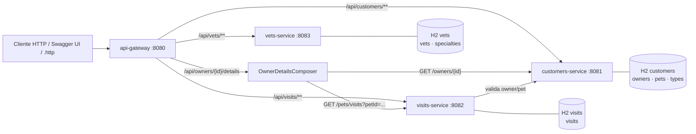

# Arquitectura

Documento vivo: se actualiza en cada fase. El análisis del legado está en
[`ANALYSIS.md`](ANALYSIS.md) y el detalle de la migración tecnológica en [`MIGRATION.md`](MIGRATION.md).

## 1. Vista general



| Módulo | Puerto | Responsabilidad | Base de datos |
|---|---|---|---|
| `api-gateway` | 8080 | Enrutado, Swagger agregado, composición owner+pets+visits | — |
| `services/customers-service` | 8081 | Owners, pets, pet types (escritura) | H2 `customers` |
| `services/visits-service` | 8082 | Visitas; valida owner/pet contra customers | H2 `visits` |
| `services/vets-service` | 8083 | Vets y especialidades (solo lectura, cacheado) | H2 `vets` |
| `libs/common-web` | — | `ProblemDetail` (RFC 9457), excepciones de dominio HTTP, `PageResponse` | — |

**Sin service discovery**: las URLs se resuelven por configuración
(`customers-service.url`, variables de entorno en Compose). Ver ADR-006.

## 2. Estructura del repositorio

```
petclinic-modernization/
├── pom.xml                       parent (packaging=pom, Java 21)
├── libs/common-web/              utilidades HTTP compartidas (sin dominio)
├── services/
│   ├── customers-service/        :8081 owners, pets, pet types
│   ├── vets-service/             :8083 vets, specialties
│   └── visits-service/           :8082 visits
├── api-gateway/                  :8080 routing + Swagger + composición
├── tests/parity-tests/           guardián regla → test (suite estática)
├── docs/                         ANALYSIS, ARCHITECTURE, API, TESTING, MIGRATION, AI_USAGE, http/
├── Dockerfile                    imagen multi-stage reutilizable (ARG MODULE/PORT)
├── docker-compose.yml            los cuatro servicios con healthchecks
├── legacy/README.md              dónde vive el monolito original (tag legacy-java21)
└── .github/workflows/ci.yml      build + tests + paridad con JDK 21
```

Dentro de cada servicio:

```
src/main/java/org/springframework/samples/petclinic/<servicio>/
├── api/            controladores, DTOs (records), mappers
├── application/    casos de uso (@Service, @Transactional)
├── domain/         entidades JPA y reglas de negocio
└── infrastructure/ repositorios Spring Data, clientes HTTP, configuración
```

La regla de dependencia es **api → application → domain**; `infrastructure` implementa lo que
necesitan las capas internas. `api` nunca habla con JPA y `domain` no conoce HTTP.

## 3. Decisiones (ADR)

### ADR-001 — Microservicios por *bounded context* en un monorepo Maven

**Contexto.** El encargo pide «arquitectura modular y/o de microservicios» y que un evaluador pueda
compilar y ejecutar todo sin pasos ocultos. El monolito tiene tres áreas con acoplamiento bajo
(owners/pets, visits, vets) y una regla que cruza (la visita debe pertenecer a un pet de un owner).

**Decisión.** Monorepo Maven multi-módulo con un servicio por contexto y un POM padre común.
`customers-service`, `visits-service`, `vets-service` + `api-gateway` + `libs/common-web`.

**Consecuencias.**
- Un único `./mvnw verify` compila y testea todo; cada módulo es un jar ejecutable independiente.
- Se paga el coste de un salto de red en la validación de visitas (mitigado con timeouts y 503).
- Se evita duplicar un modelo de datos compartido: cada servicio tiene su esquema.

### ADR-002 — Gateway con Spring Cloud Gateway 5.0.4 (variante MVC)

**Contexto.** META_PROMPT §6 exige comprobar si existe un *release train* de Spring Cloud
compatible con Boot 4.1 y, si no, aplicar el plan B (gateway sin Spring Cloud).

**Decisión.** El train **2025.1.4 (Oakwood)** declara compatibilidad con Spring Boot **4.0.x y
4.1.x** (desde 2025.1.2, tabla oficial de spring.io). Se usa
`spring-cloud-starter-gateway-server-webmvc` 5.0.4, la variante **servlet**, con la Java Routes API.
**No se aplica el plan B.**

**Consecuencias.**
- Un solo stack (Spring MVC) en todos los módulos: sin WebFlux ni Reactor en el gateway.
- Las rutas se declaran en código (`RouterFunction`) y se testean como cualquier otro bean.
- Se renuncia a filtros exclusivos de la variante WebFlux (p. ej. `RequestRateLimiter` reactivo).

### ADR-003 — Una base de datos por servicio (H2 por defecto)

**Contexto.** «Sin entidades compartidas» y arranque local sin infraestructura.

**Decisión.** Cada servicio define su propio `schema.sql`/`data.sql` sobre H2 en memoria; el perfil
`postgres` es opcional y se documenta como trabajo futuro (no bloquea la entrega).

**Consecuencias.**
- `./mvnw verify` no necesita Docker.
- La integridad referencial entre contextos es **eventual y por contrato HTTP**, no por FK: la
  valida `visits-service` al crear una visita.
- Un borrado de owner no se propaga a visitas (limitación documentada).

### ADR-004 — Paginación REST

**Contexto.** El monolito redirigía (`302`) a `page=1` cuando el usuario pedía una página fuera de
rango, y `page=0` rompía `PageRequest`.

**Decisión.** El contrato REST usa `page` (1-based) y `size` (por defecto 5, máximo 100).
- `page < 1` → se sirve la página 1.
- `page > totalPages` → se sirve la página 1 (nunca 302 ni 404).
- `size` fuera de `[1, 100]` → `400` con `ProblemDetail`.
- La respuesta incluye `page`, `size`, `totalElements`, `totalPages`, `first`, `last`.

**Consecuencias.** Un cliente siempre recibe contenido coherente y sabe qué página está viendo.
Se pierde la señal de «te pasaste de página», sustituida por los metadatos. El orden es estable
(`lastName, firstName, id`) para que la paginación no baile (corrige BR-OWN-14).

### ADR-005 — Errores uniformes con `ProblemDetail` (RFC 9457)

**Contexto.** El monolito devolvía `500` para recursos inexistentes (`IllegalArgumentException`) y
errores de validación atados a la vista.

**Decisión.** Todos los servicios usan `ProblemDetail` con `type`, `title`, `status`, `detail`,
`instance` y, en validaciones, `errors: [{field, message}]`.
- recurso inexistente → **404**
- conflicto de unicidad → **409**
- validación → **400**
- dependencia caída → **503** (solo `visits-service` y el compositor del gateway)

**Consecuencias.** Contrato único, testeable y documentado en OpenAPI. Los clientes del monolito que
esperaban 500 deben adaptarse (ver `MIGRATION.md` §4).

### ADR-006 — Sin descubrimiento de servicios

**Decisión.** No se añade Eureka/Consul: las URLs de los servicios son configuración
(`customers-service.url`, `CUSTOMERS_SERVICE_URL` en Compose).

**Consecuencias.** Menos piezas que arrancar y explicar; en un despliegue real se sustituiría por
DNS de plataforma (Kubernetes) o un *service registry*.

## 4. Contratos REST (resumen)

Prefijo a través del gateway: `/api/<servicio>`. Detalle completo, ejemplos y códigos en
[`API.md`](API.md) y en `docs/http/*.http`.

| Servicio | Endpoint | Códigos |
|---|---|---|
| customers | `GET /owners?lastName=&page=&size=` | 200, 400 |
| customers | `GET /owners/{ownerId}` | 200, 404 |
| customers | `POST /owners` | 201 + `Location`, 400 |
| customers | `PUT /owners/{ownerId}` | 200, 400, 404 |
| customers | `GET /petTypes` | 200 |
| customers | `GET /owners/{ownerId}/pets/{petId}` | 200, 404 |
| customers | `POST /owners/{ownerId}/pets` | 201 + `Location`, 400, 404, 409 |
| customers | `PUT /owners/{ownerId}/pets/{petId}` | 200, 400, 404, 409 |
| visits | `GET /owners/{ownerId}/pets/{petId}/visits` | 200, 404 |
| visits | `POST /owners/{ownerId}/pets/{petId}/visits` | 201 + `Location`, 400, 404, 503 |
| visits | `GET /pets/visits?petId=1,2` | 200 |
| vets | `GET /vets?page=&size=` | 200, 400 |
| vets | `GET /vets/all` | 200 (`{ "vetList": [...] }`) |
| gateway | `GET /api/owners/{ownerId}/details` | 200, 404, 503 |
| gateway | `/api/system/boom` | 500 (demostración de manejo de errores) |

**Reescritura de rutas**: `customers` y `visits` se publican como `/api/<servicio>/<recurso>` y el
gateway elimina los dos primeros segmentos (`/api/customers/owners/1` → `/owners/1`). `vets` ya
publica sus recursos bajo `/vets`, así que solo se elimina `/api` (`/api/vets/all` → `/vets/all`).

## 5. Contenedores, CI y calidad

- **Imagen**: `Dockerfile` multi-stage. La etapa de build ejecuta
  `./mvnw -pl ${MODULE} -am -DskipTests package` y la de runtime usa `eclipse-temurin:21-jre` con
  `curl` para los healthchecks. Una sola imagen parametrizada evita cuatro Dockerfiles duplicados.
- **Compose**: cuatro servicios, `depends_on` por `condition: service_healthy` y las URLs inyectadas
  por entorno (`CUSTOMERS_SERVICE_URL`, `VETS_SERVICE_URL`, `VISITS_SERVICE_URL`).
- **CI** (`.github/workflows/ci.yml`): JDK 21 (temurin), `./mvnw -B verify` en `push` y
  `pull_request` a `main`/`develop`, y publicación de los informes JaCoCo como artefacto. El
  `verify` incluye la suite de paridad, así que una regla sin test rompe la CI.
- **Calidad**: `spring-javaformat` en `validate`, `maven-enforcer` exigiendo JDK 21, JaCoCo por
  módulo y `tests/parity-tests` como guardián de trazabilidad.
- **Workflows retirados** (documentados en `MIGRATION.md`): Gradle, despliegue a k8s y el check DCO.

## 6. Observabilidad y operación

- Actuator en todos los módulos: `/actuator/health`, `/actuator/info`, `/actuator/metrics`.
- `build-info` y `git.properties` no se generan en la versión multi-módulo (simplificación).
- Hilos virtuales activos (`spring.threads.virtual.enabled=true`) en los tres servicios.
- Logs por consola con nivel INFO; `logging.level.org.springframework=INFO` heredado del perfil.

## 7. Fuera de alcance (declarado)

- **Frontend**: no se porta Thymeleaf. La UI de inspección es Swagger UI y los `.http`.
- **Seguridad**: sin autenticación ni autorización (no está en el enunciado).
- **Mensajería/Kafka, Eureka, Config Server**: innecesarios para el alcance y coste de la prueba.
- **PostgreSQL real**: esquemas preparados y documentados, sin *pipeline* de CI con Testcontainers
  (no hay Docker en la máquina de desarrollo).

