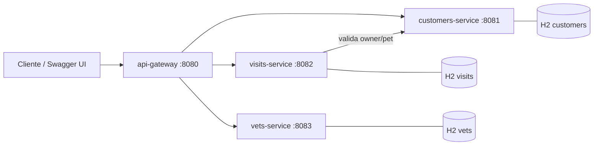

# Arquitectura objetivo

## Decisión principal (ADR-001)

**Microservicios por bounded context dentro de un monorepo Maven multi-módulo.**
Motivo: cumple "modular y/o microservicios", permite un único `./mvnw verify` para el evaluador,
y cada servicio es desplegable de forma independiente. Base de datos **por servicio** (H2 en memoria
por defecto; perfil `postgres` opcional). Sin service discovery (Eureka) para no inflar el alcance:
URLs por configuración/variables de entorno (en compose, nombres DNS de servicio).

```
petclinic-modernization/
├── pom.xml                      (parent, packaging=pom, Java 21)
├── services/
│   ├── customers-service/       :8081  owners, pets, pet types
│   ├── vets-service/            :8083  vets, specialties
│   └── visits-service/          :8082  visits (llama a customers)
├── api-gateway/                 :8080  routing + Swagger agregado + composición
├── docs/  (ANALYSIS, ARCHITECTURE, API, TESTING, MIGRATION, AI_USAGE, http/)
├── docker-compose.yml
└── .github/workflows/ci.yml
```

Opcional: módulo `libs/common-web` (ProblemDetail handler, config OpenAPI común). Solo si evita
duplicación real; no compartir entidades entre servicios.

Estructura interna de cada servicio (paquetes):
`api` (controllers + DTO records + mappers) · `application` (servicios/casos de uso) ·
`domain` (entidades, reglas) · `infrastructure` (repositorios, clientes HTTP, config).



## Contratos REST propuestos (prefijo vía gateway: `/api/<servicio>`)

### customers-service
| Método | Ruta | Respuesta | Reglas |
|---|---|---|---|
| GET | `/owners?lastName=&page=&size=` | 200 `Page<OwnerSummary>` | BR-OWN-06/07 (size por defecto 5) |
| GET | `/owners/{ownerId}` | 200 `OwnerDetails` (con pets) / 404 | BR-OWN-09 |
| POST | `/owners` | 201 + `Location` / 400 | BR-OWN-01..05, 11 |
| PUT | `/owners/{ownerId}` | 200 / 400 / 404 | BR-OWN-10 |
| GET | `/petTypes` | 200 lista ordenada | BR-PET-08 |
| GET | `/owners/{ownerId}/pets/{petId}` | 200 / 404 | BR-PET-07 |
| POST | `/owners/{ownerId}/pets` | 201 / 400 / 404 / 409 | BR-PET-01..04 |
| PUT | `/owners/{ownerId}/pets/{petId}` | 200 / 400 / 404 / 409 | BR-PET-05/06 |

### visits-service
| Método | Ruta | Respuesta | Reglas |
|---|---|---|---|
| GET | `/owners/{ownerId}/pets/{petId}/visits` | 200 lista por fecha | BR-PET-09 |
| POST | `/owners/{ownerId}/pets/{petId}/visits` | 201 / 400 / 404 / 503 | BR-VIS-01..03 |
| GET | `/pets/visits?petId=1,2,3` | 200 (para composición) | — |

### vets-service
| Método | Ruta | Respuesta | Reglas |
|---|---|---|---|
| GET | `/vets?page=&size=` | 200 paginado (5) | BR-VET-01 |
| GET | `/vets/all` | 200 `{ "vetList": [...] }` JSON/XML | BR-VET-02/03/04 |

### api-gateway
- Rutas a los tres servicios.
- `GET /api/owners/{ownerId}/details` → owner + pets + visitas (composición).
- Swagger UI agregado en `/swagger-ui.html`.

**Paginación**: decidir y documentar cómo se traduce la "redirección a página 1" del MVC en REST
(opciones: 400 con ProblemDetail, o devolver la página 1 con cabecera/meta). Documentar en
`docs/MIGRATION.md`. Hay que parar el overflow de `page`/`size` (límite máximo de `size`, p. ej. 100).

**Errores**: `ProblemDetail` (RFC 9457) uniforme: `type`, `title`, `status`, `detail`, `instance`,
y `errors: [{field, message}]` para validación.

## Plan B del gateway (si no hay Spring Cloud compatible con la versión de Boot)

Opción 1: bajar el parent a la última Boot 3.5.x con su train de Spring Cloud compatible
(documentar el porqué; Java 21 se mantiene).
Opción 2: gateway ligero con Spring MVC + `RestClient` (proxy explícito de rutas) — más código, sin
dependencias extra. Elegir 1 salvo que haya bloqueos; registrar ADR.

## Frontend

Fuera de alcance (opcional en la prueba). El agente **no** porta las vistas Thymeleaf; la UI es
Swagger UI + archivos `.http`. Documentarlo.
